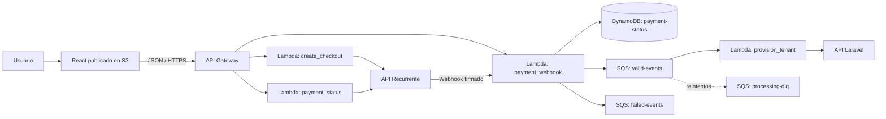

# Payment Gateway Serverless

> **Estado:** proyecto en proceso de desarrollo. La arquitectura y la infraestructura pueden cambiar antes de una versión productiva.

Pasarela de pagos serverless para una aplicación React. El proyecto expone una API para crear checkouts y consultar su estado, recibe webhooks de [Recurrente](https://recurrente.com/), persiste el estado de los pagos y procesa eventos de activación de tenants hacia una API Laravel.

El frontend compilado de React se publica en un bucket de Amazon S3. Cloudflare expone el dominio público del frontend mediante un Worker que sirve los archivos estáticos del bucket.

## Arquitectura



### Componentes

| Componente | Responsabilidad |
| --- | --- |
| Amazon S3 | Almacena y sirve el build estático de React (`index.html`, JavaScript, CSS y assets). |
| Cloudflare Worker | Publica el frontend bajo el dominio configurado y resuelve `/` hacia `index.html`. |
| API Gateway | Expone los endpoints HTTP de la pasarela y las respuestas CORS. |
| AWS Lambda | Ejecuta la lógica de checkout, consulta de estado, webhook y provisión de tenants. |
| Recurrente | Proveedor externo para crear checkouts, consultar pagos y enviar webhooks. |
| DynamoDB | Guarda el estado de pagos y las claves de idempotencia. |
| SQS | Desacopla el procesamiento del webhook y los eventos de activación. |
| Secrets Manager | Almacena la llave de API de Recurrente, el secreto de firma del webhook y el token de Laravel. |
| CloudWatch Logs | Conserva los logs de las funciones Lambda según `lambda_log_retention_days`. |

## Estructura del repositorio

```text
.
├── functions/
│   ├── create_checkout/       # Crea checkouts en Recurrente
│   ├── payment_status/        # Consulta el estado de un checkout
│   ├── payment_webhook/       # Valida y encola webhooks
│   └── provision_tenant/      # Consume SQS y llama a Laravel
├── terraform/                 # Infraestructura AWS y Cloudflare
├── test/                      # Pruebas del proyecto
├── docs/                      # Diagrama/documentación visual del flujo
└── README.md
```

## Flujo de pago

1. La aplicación React llama a `POST /checkout` con una clave `Idempotency-Key`.
2. `create_checkout` valida el monto, registra la solicitud en DynamoDB y crea el checkout en Recurrente.
3. La Lambda devuelve el `checkout_id` y la `checkout_url` para redirigir al usuario.
4. Recurrente envía el resultado a `/webhook` o `/webhook/recurrente`.
5. `payment_webhook` valida la firma Svix/Recurrente, guarda el estado en DynamoDB y publica el evento válido en SQS.
6. `provision_tenant` consume la cola y notifica la activación a la API Laravel usando una clave de idempotencia.
7. El frontend puede consultar `GET /estado?checkout_id=...` para obtener el estado directamente desde Recurrente.

La idempotencia evita crear checkouts o procesar webhooks duplicados. Una misma clave reutilizada con un payload diferente responde con conflicto (`409`).

## Endpoints

La API utiliza el stage definido por `environment`. Sin dominio personalizado, la URL base tiene la forma:

```text
https://<api-id>.execute-api.<aws-region>.amazonaws.com/<environment>
```

Si se configura `api_custom_domain_name`, la URL base será el dominio personalizado, por ejemplo `https://payment.apisys.info`.

### Crear checkout

`POST /checkout`

Headers:

```http
Content-Type: application/json
Idempotency-Key: checkout-orden-123
```

Body mínimo:

```json
{
  "amount": 49.99,
  "currency": "USD",
  "quantity": 1,
  "product_name": "Suscripción mensual"
}
```

También se pueden enviar `items`, `success_url` y `cancel_url`. La respuesta exitosa es `201`:

```json
{
  "checkout_id": "checkout_123",
  "checkout_url": "https://app.recurrente.com/..."
}
```

Respuestas relevantes: `400` para datos inválidos, `409` para conflictos de idempotencia, `502` si Recurrente no responde y `500` para errores internos.

### Consultar estado

`GET /estado?checkout_id=<checkout_id>`

El handler también acepta `id` como parámetro alternativo. La Lambda consulta el checkout en Recurrente y devuelve su respuesta.

### Webhook de pago

`POST /webhook`  
`POST /webhook/recurrente`

Ambas rutas usan la misma Lambda. El request debe incluir los headers de firma de Svix:

```http
svix-id: ...
svix-timestamp: ...
svix-signature: ...
```

Las firmas con más de cinco minutos de antigüedad se rechazan. Los webhooks inválidos se responden con `401` y se envían a `failed-events` cuando la cola está configurada.

## Requisitos

- Terraform `>= 1.5.0`.
- Una cuenta de AWS con permisos para API Gateway, Lambda, IAM, S3, DynamoDB, SQS, Secrets Manager y CloudWatch Logs.
- Credenciales AWS configuradas mediante perfil, variables de entorno o la cadena estándar de credenciales.
- Python 3.12 para desarrollo y pruebas locales.
- Una cuenta de Recurrente y sus credenciales.
- Una API Laravel accesible públicamente para recibir la provisión del tenant.
- Cuenta y token de Cloudflare si se publicarán dominios personalizados.
- Un certificado ACM en `us-east-1` para el dominio personalizado del frontend y/o el dominio de API, según la configuración usada.

## Configuración

1. Copia el archivo de ejemplo:

   ```powershell
   Copy-Item terraform/terraform.tfvars.example terraform/dev.tfvars
   ```

2. Completa `terraform/dev.tfvars`. Como mínimo, revisa:

   - `project_name`, `environment` y `aws_region`.
   - `frontend_bucket`, que debe ser un nombre S3 globalmente único.
   - `cloudflare_account_id`, `cloudflare_zone_id` y `worker_script`.
   - `frontend_domain_name` si el frontend tendrá subdominio propio.
   - `api_custom_domain_name` y `api_certificate_arn` si la API tendrá dominio propio.
   - `recurrente_success_url`, `recurrente_cancel_url` y `cors_allow_origin`.
   - `laravel_api_base_url` y `laravel_api_provision_path`.
   - Los ARN de Secrets Manager para Recurrente, el webhook y Laravel.

3. Crea en AWS Secrets Manager los secretos referenciados por ARN. Se aceptan tanto valores de texto plano como JSON con estas llaves:

   | Secreto | Llaves JSON aceptadas |
   | --- | --- |
   | API de Recurrente | `secret_key`, `api_key`, `recurrente_secret_key` o `key` |
   | Firma del webhook | `signing_secret`, `signingSecret`, `webhook_secret` o `secret` |
   | Token de Laravel | `token`, `api_token`, `laravel_api_token` o `secret` |

No guardes las credenciales directamente en `terraform.tfvars`; el archivo está ignorado por Git. Los valores `*_secret_arn` solo contienen referencias a Secrets Manager.

## Despliegue de infraestructura

Desde la raíz del proyecto:

```powershell
Set-Location terraform
terraform init
terraform fmt -check
terraform validate
terraform plan -var-file=dev.tfvars
terraform apply -var-file=dev.tfvars
```

Guarda los outputs que imprime Terraform:

```powershell
terraform output api_base_url
terraform output api_custom_domain_url
terraform output frontend_bucket_name
terraform output frontend_url
```

## Publicar el frontend React en S3

El repositorio contiene la infraestructura del bucket, pero no el código fuente de React. Genera el build en el proyecto frontend y sincroniza la carpeta resultante con el bucket indicado por Terraform:

```powershell
$bucket = terraform -chdir=terraform output -raw frontend_bucket_name
npm ci
npm run build
aws s3 sync .\dist "s3://$bucket" --delete
```

Si el proyecto React genera la salida en `build` en lugar de `dist`, reemplaza `\.\dist` por `\.\build`.

La configuración de S3 usa `index.html` como documento principal y como documento de error, lo que permite el fallback necesario para las rutas de una SPA React. El bucket tiene versionado y cifrado del lado del servidor habilitados.

## Cloudflare y dominios

El frontend se publica mediante el Worker definido en `terraform/cdn.tf`. El Worker:

- acepta únicamente `GET` y `HEAD`;
- sirve `/index.html` cuando la ruta recibida es `/`;
- conserva los query strings;
- devuelve `405` para otros métodos;
- recibe el nombre del bucket mediante el binding `S3_BUCKET`;
- recibe la región AWS mediante el binding `S3_REGION`.

La API puede asociarse a un dominio regional de API Gateway y Cloudflare crea el registro CNAME cuando están configurados `cloudflare_zone_id`, `api_custom_domain_name` y `api_certificate_arn`.

El nombre del bucket y la región no están escritos como valores fijos en el código del Worker. Terraform los inyecta desde `aws_s3_bucket.frontend.id` y `var.aws_region`, respectivamente, al crear los bindings `S3_BUCKET` y `S3_REGION`.

### Actualizar el Worker

Los cambios del Worker se administran desde `terraform/cdn.tf`. Para actualizar el script, cambiar el nombre del Worker o refrescar los bindings del bucket:

```powershell
Set-Location terraform
terraform plan -var-file=dev.tfvars
terraform apply -var-file=dev.tfvars
```

Al ejecutar `terraform apply`, Cloudflare recibe el código actualizado y Terraform vuelve a generar `S3_BUCKET` y `S3_REGION` con los valores actuales de AWS. No es necesario editar manualmente el script en el panel de Cloudflare.

## Recursos creados

Terraform crea, entre otros, estos recursos:

- 4 funciones Lambda con runtime Python 3.12.
- API Gateway REST regional con stage igual a `environment`.
- Bucket S3 para el frontend React, con website configuration, versionado y cifrado.
- Tablas DynamoDB `payment-status` e `idempotency`, bajo demanda y con recuperación point-in-time.
- Colas SQS `valid-events`, `failed-events` y `processing-dlq`.
- Rol IAM compartido por las Lambdas con permisos para logs, DynamoDB, SQS y Secrets Manager.
- Grupos de logs de CloudWatch con la retención configurada.
- Worker y registros DNS de Cloudflare cuando se proporcionan sus variables.

## Operación y troubleshooting

Para revisar la operación del sistema:

```powershell
aws logs tail /aws/lambda/pay-gateway-serverless-dev-create-checkout --follow
aws logs tail /aws/lambda/pay-gateway-serverless-dev-payment-webhook --follow
aws sqs get-queue-attributes --queue-url <valid-events-queue-url> --attribute-names ApproximateNumberOfMessages ApproximateNumberOfMessagesNotVisible
```

Casos comunes:

- `400` en checkout: verifica `amount`, `quantity` y que exista `Idempotency-Key`.
- `409` en checkout o webhook: la clave ya está en uso, el request sigue procesándose o el payload cambió.
- `401` en webhook: revisa el secreto de firma, los headers `svix-*` y la hora del sistema.
- `502` al crear o consultar: valida la conectividad y la configuración de la API de Recurrente.
- Eventos acumulados en `valid-events`: revisa logs de `provision-tenant`, `LARAVEL_API_BASE_URL` y el token de Laravel.
- Mensajes en `processing-dlq`: corrige la causa en Laravel o en el procesamiento antes de reencolarlos.

## Seguridad

- No incluyas llaves de Recurrente, secretos de firma ni tokens de Laravel en el código fuente.
- Restringe `cors_allow_origin` al dominio real del frontend en ambientes productivos.
- Protege el acceso administrativo a AWS, Cloudflare y Terraform state.
- Revisa la política del bucket S3 y el Worker antes de usar datos sensibles en el frontend: todo asset publicado en S3 debe considerarse público.
- No almacenes datos completos de tarjetas; el checkout y el procesamiento sensible permanecen en Recurrente.

## Estado del proyecto

Este es un proyecto en proceso de desarrollo. La infraestructura está definida como código en Terraform y las funciones Lambda se empaquetan automáticamente desde `functions/` mediante el provider `archive`. Antes de un despliegue productivo, valida los dominios, el origen del Worker, los secretos, los permisos IAM y la política de CORS del ambiente correspondiente.
